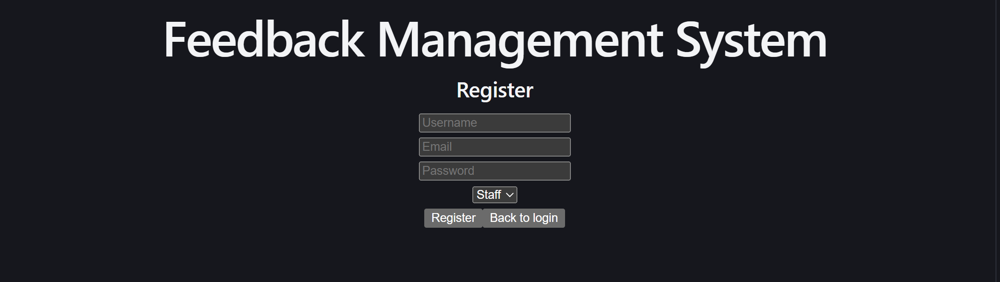
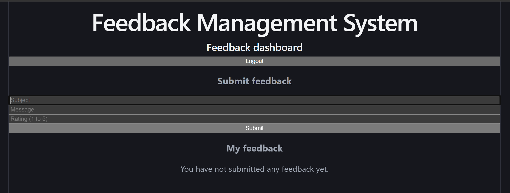
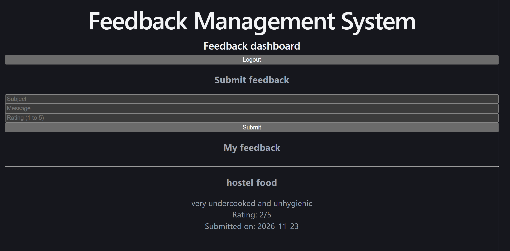
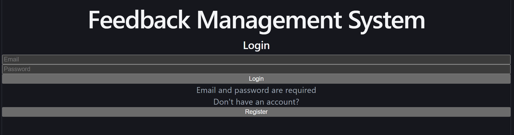
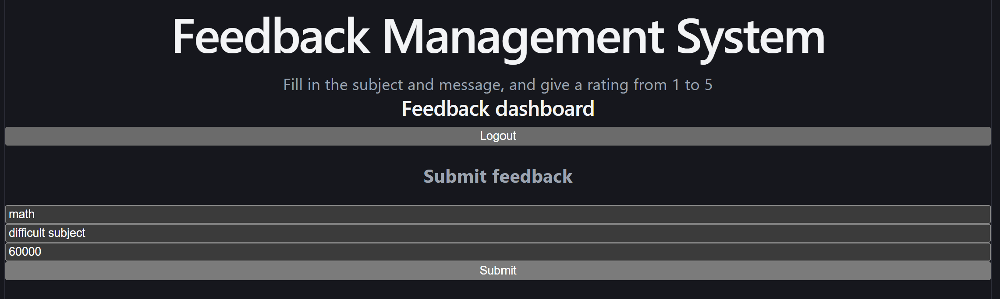
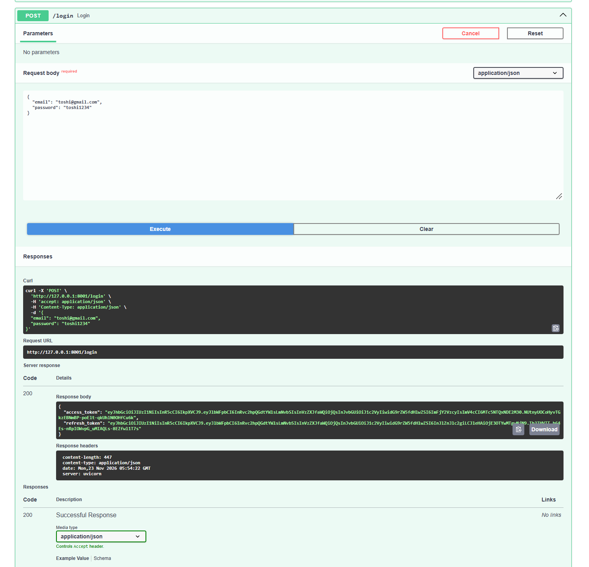
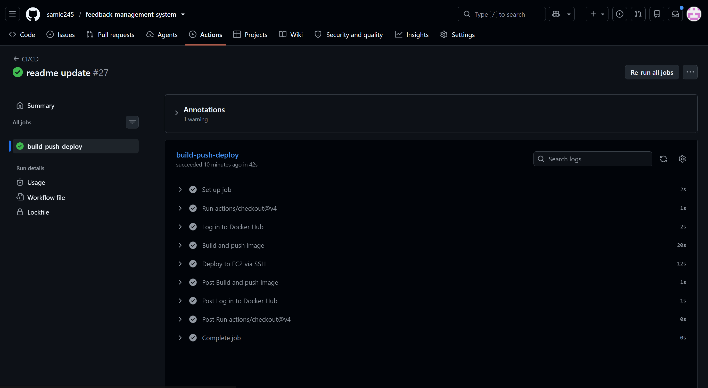

# Feedback Management System

## 1. Project and team

A feedback app where users register, log in with JWT access and refresh tokens, submit feedback (subject, message, rating from 1 to 5) and see only their own feedback. Passwords are stored as Argon2 hashes. FastAPI + SQLite backend (port 8001), React frontend, Docker, GitHub Actions and AWS EC2.

| Member | Backend | Frontend |
|:-------|:--------|:---------|
| **Toshimah** | A1 register, A2 login and A3 refresh token endpoints (`main.py`, `functions.py`) | Register page |
| **Samhita** | E1 get feedback endpoint (`main.py`), Pydantic request validation (`model.py`) | Login page |
| **Darsh** | E2 submit feedback endpoint (`main.py`) | Feedback dashboard (`Dashboard.jsx`): loads the user's feedback, submit form, logout and refresh-token handling |

## 2. Live app

**Public link:** "http://3.111.42.28:8001/docs"

## 3. How to run it

### Backend
```bash
cd backend
py -3.12 -m venv venv
venv\Scripts\Activate.ps1
pip install -r requirements.txt
uvicorn main:app --reload --port 8001
```
On Mac or Linux, use `python3.12 -m venv venv` and `source venv/bin/activate`. Open the API docs at http://127.0.0.1:8001/docs.

### Frontend
Start the backend first, then in a second terminal:
```bash
cd frontend
npm install
npm run dev
```
Open http://localhost:5174.

### Docker container
```bash
cd backend
docker build -t feedback-backend .
docker run -d --name feedback-app -p 8001:8001 feedback-backend
```
Open http://3.111.42.28:8001/docs To stop it and remove the container:
```bash
docker stop feedback-app
docker rm feedback-app
```

## 4. API contract

| # | What it does | Method | Path | Request body | Success code |
|:-:|:-------------|:------:|:-----|:-------------|:------------:|
| A1 | Register a new user | POST | /register | username<br>email<br>password<br>role (optional, `staff` or `user`) | 200 |
| A2 | Log in and get access and refresh tokens | POST | /login | email<br>password | 200 |
| A3 | Get a new access token | POST | /refresh | none (refresh token in the `refresh-token` header) | 200 |
| E1 | Get all feedback of the logged-in user | GET | /feedback | none (access token in the `token` header) | 200 |
| E2 | Submit new feedback | POST | /feedback | subject<br>message<br>rating (access token in the `token` header) | 201 |

### Error rules

Every error returns `{"detail": "..."}`.

| Rule | Status |
|:-----|:------:|
| Registering with an email that already exists | 409 |
| Logging in with a wrong email or password | 401 |
| Invalid or expired access token (or no token) | 401 |
| Invalid or expired refresh token | 401 |
| Role not allowed to use the endpoint | 403 |
| Missing or empty required field | 422 |
| Rating below 1 or above 5 | 422 |
| Invalid email format | 422 (not checked yet, see Known issues) |

## 5. Database

One SQLite file, `feedback.db`, with two tables.

**users**

| Column | Notes |
|:-------|:------|
| id | primary key |
| username | |
| email | unique |
| password | stores the Argon2 hash, never the plain password |
| role | `staff` (default) or `user` |
| created_at | |

**feedback**

| Column | Notes |
|:-------|:------|
| id | primary key |
| user_id | foreign key to `users.id` |
| subject | |
| message | |
| rating | 1 to 5 |
| created_at | |

## 6. Screenshots


The register page, where a new user enters a username, email and password.


The login page, where the user logs in with email and password.


The dashboard showing the logged-in user's feedback with subject, message, rating and date.



An API error shown on the page.!


An endpoint returning a successful response in Swagger `/docs`.


A successful GitHub Actions run that builds the Docker image and deploys it to EC2.

## 7. Known issues

- An invalid email format is not rejected, because the email field is a plain string.
- The tokens are kept in React state, so refreshing the browser logs the user out.
- Submitting feedback with an expired access token shows an error, and the user must log in again. Only loading the dashboard refreshes the token automatically.